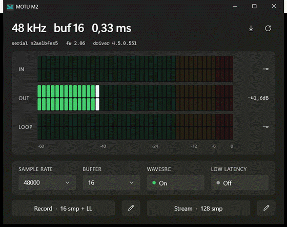
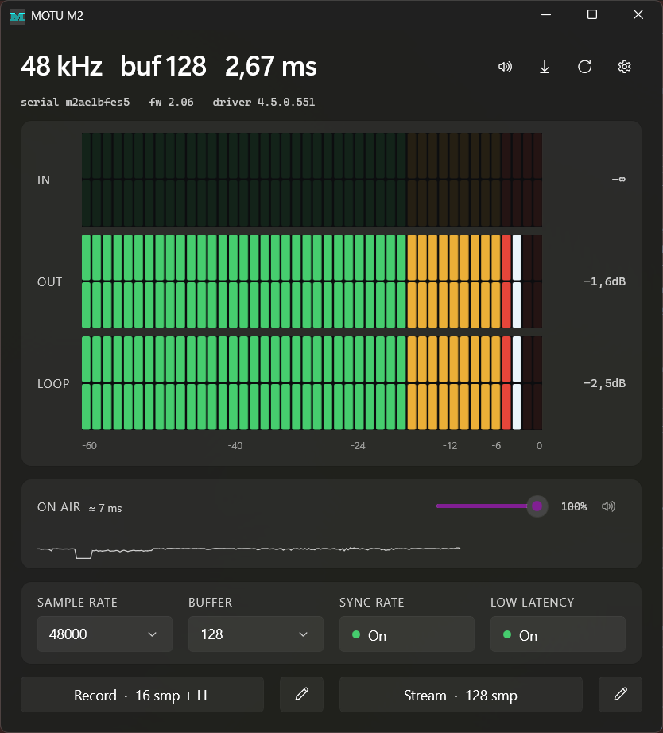
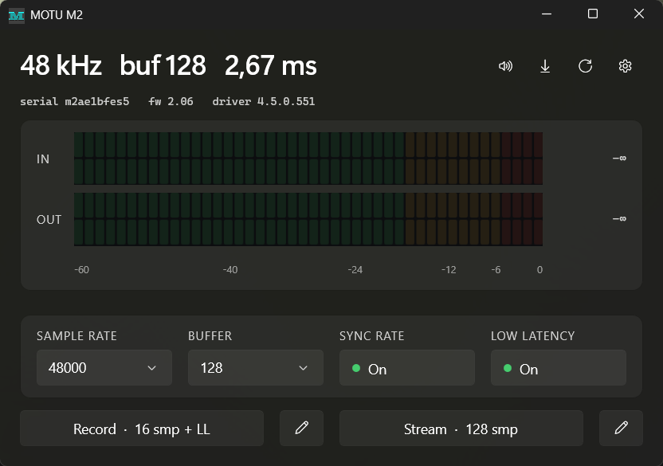
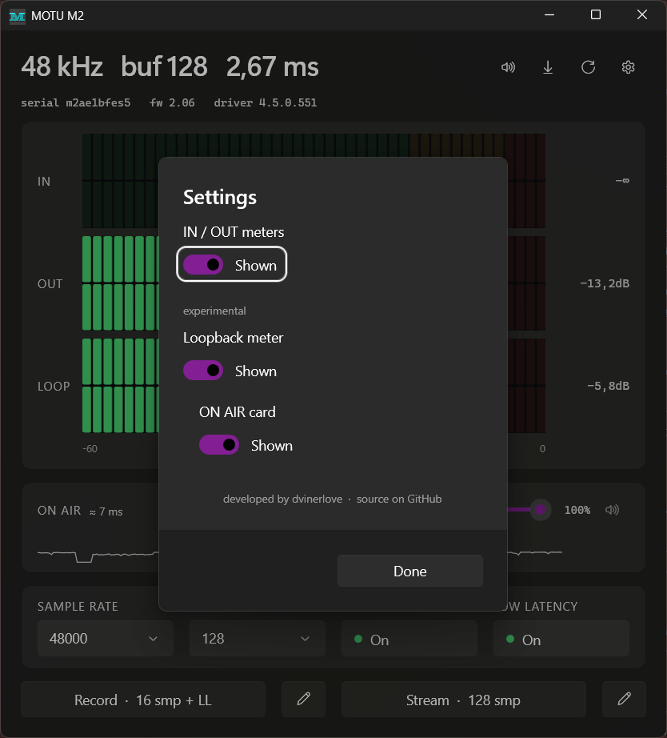

# motu-ui

[](https://github.com/dvinerlove/motu-ui/releases/latest)
[](LICENSE)
[](https://github.com/dvinerlove/motu-ui/releases)

An unofficial open-source control panel for MOTU M2, M4, and M6 audio
interfaces on Windows — with live meters, a loopback monitor, and editable
presets the stock panel doesn't have.

It talks to the hardware through the official MOTU driver library — every
control is a real driver call, nothing is faked.





<details><summary>More views</summary>




</details>

## Download

Grab either build from
[Releases](https://github.com/dvinerlove/motu-ui/releases) — both are
self-contained, no .NET needed:

- **portable** `motu-ui-v1.1.8-win-x86-portable.exe` — a single file, nothing
  to unzip. On first launch it unpacks itself to a temp dir and runs.
- **zip** `motu-ui-v1.1.8-win-x86.zip` — the classic loose layout; smaller
  download, fastest startup. Unzip and run `motu-ui.exe`.

Presets and settings live in `%LOCALAPPDATA%\motu-ui`, so both builds share
the same state.

## What it does

- **Live input/output meters** — stereo LED ladders with peak hold and clip
  indication, no DAW needed to see if signal is flowing
- **Loopback meter** — a third ladder showing the loopback capture endpoint,
  i.e. exactly what OBS and other recorders hear, plus a 30-second history strip
- **On-air app list** — every app feeding the loopback bus, with a live level
  and a per-app mute
- **Bus level and mute** — a fader for how loud recorders hear the bus,
  independent of your monitor volume, plus one click to silence it entirely
- **Experimental gate** — the ON AIR card is hidden by default; the puzzle
  icon in the title row turns it on (the window grows to fit it)
- **Test tone** — the speaker button plays a 440 Hz signal through the
  device, so you can watch OUT and LOOP light up, confirm loopback works for
  your stream/recording, and see the measured loop delay in ms
- **Loopback health hints** — warns when Loopback Mix is live (your mic rides
  the bus — echo risk) or when OUT plays but the loop stays silent
- **Sample rate and buffer size** — apply instantly, with latency readout
- **Low latency mode** — the driver switch the stock panel calls "Use lowest
  latency safety offsets"; here it's one click
- **Sync rate** — syncs Windows' sample rate to the device, same switch and
  polarity as the stock panel's checkbox (off = the driver's WaveSRC resampler
  handles apps at other rates)
- **Presets** — two buttons (Record / Stream by default), each editable via the
  pencil next to it; stored in a JSON file next to the exe
- **Driver update check** — pulls the current version from motu.com for your
  specific model and runs the official installer if newer
- Follows the system light/dark theme, scales correctly on high-DPI displays,
  and resizes down to a compact window

## Requirements

- A MOTU M2, M4, or M6 connected over USB
- Windows 10/11 with the official MOTU M-Series driver installed
  (the app loads `MSeriesLib.dll` from the driver directory)

## Build

```
dotnet build -c Release
```

Output lands in `bin\x86\Release\net10.0-windows10.0.19041.0\win-x86\`.

**Why x86:** the installed MOTU library is 32-bit, so the app must run as
x86. Everything else (Windows App SDK runtime included) is self-contained.

## motu-ui vs the stock M-Series panel

| | Stock MOTU panel | motu-ui |
|---|---|---|
| Sample rate | yes | yes |
| Buffer size | yes | yes, with latency readout |
| Live I/O meters | no | yes — peak hold + clip |
| Loopback monitor | no | yes — what OBS hears |
| Test tone | no | yes — one-click signal check |
| Low latency mode | yes ("safety offsets") | one click |
| Sample-rate sync | yes | same polarity as the stock checkbox |
| Presets | no | editable |
| Driver update check | no | per your model, from motu.com |
| Window | fixed size | Mica, theme-aware, resizable |

Screenshots: [preset editing](docs/preset-edit.png) ·
[driver update check](docs/update-check.png)

## FAQ

**Is there a mixer for the MOTU M2?**
No — the M2, M4, and M6 have no DSP mixing hardware, so no tool can offer a
software mixer for them. motu-ui is a control and status panel: it shows
live meters and exposes every setting the driver actually has.

**Is there software for the MOTU M2 besides the official panel?**
Yes — motu-ui is a third-party alternative. Other third-party MOTU tools
target the older AVB interfaces (UltraLite AVB, 1248, 16A), which M-series
units are not.

**What is WaveSRC / "Sync Windows sample rate" on a MOTU interface?**
They're the same driver flag, shown with opposite polarity. WaveSRC is the
driver-level resampler for Windows (WAVE) audio: on, apps can run at any
sample rate; off, apps must match the device rate for a bit-exact path. The
stock panel's "Sync Windows sample rate to device" checkbox is checked when
WaveSRC is off — motu-ui's SYNC RATE toggle matches the stock checkbox, so
both panels always agree.

**What is LOW LATENCY?**
The same switch as the stock panel's "Use lowest latency safety offsets"
checkbox. On = the driver reports a zero output safety offset — lowest
latency, but some systems get clicks and pops; off = the normal offset.
The button reads the real device state the same way the stock panel does.

**What do the ON AIR controls actually change?**
WASAPI volumes, not the MOTU driver. The bus fader and mute set the loopback
capture endpoint's Windows volume — how loud recorders hear it, independent
of your monitor level. Each app's level/mute is its Windows session volume,
which is global: muting an app silences it for you too, not just on stream.

**How do the controls map to the stock panel?**
SAMPLE RATE and BUFFER are the same driver calls as the stock dropdowns;
SYNC RATE is the stock "Sync Windows sample rate" checkbox (the WaveSRC flag
inverted); LOW LATENCY is "Use lowest latency safety offsets". The ON AIR
controls have no stock equivalent — they live in Windows audio, not in the
driver.

**Does motu-ui replace the MOTU driver?**
No. It uses the official M-Series driver library, so the driver must be
installed. Think of it as a better front panel for the driver you already
have.

**Does it work on the M4 or M6?**
Yes — the app reads the connected model and adjusts the update check and
channel layout. The meters currently show the first stereo pair on
multi-channel models.

## Notes

- Low latency mode is read back the same way the stock panel does it — a zero
  output safety offset means it's on.
- On M4/M6 the meters show the first stereo pair.
- Changing sample rate or buffer invalidates the audio endpoints for a moment;
  the meters reconnect automatically.
- The app touches the driver only while a control is actually used — an idle
  motu-ui holds no device session, so the stock panel keeps working alongside
  it.
- Per-app mutes in the ON AIR list set the app's Windows session volume —
  they silence it everywhere, not just on the stream.
